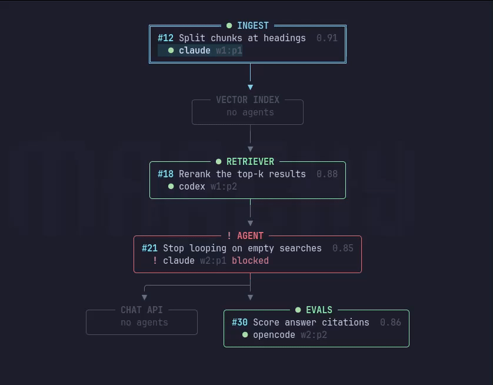

# herdr-map

A terminal view of what your [herdr](https://herdr.dev) agents are doing: which **GitHub issue** each one is on, and which **module** of the project each issue touches. Modules are drawn as a data-flow diagram, so you can see where agents' work meets.



## Install

Needs Rust (stable), [herdr](https://herdr.dev), `git`, an authenticated `gh`, and `curl` 8.3+.

```sh
git clone git@github.com:javier-abia/herdr-map.git
cargo install --path herdr-map
export HERDR_MAP_OPENROUTER_API_KEY=sk-or-...   # used to place issues in modules with jev model
```

## Use

**1. Make the module map.** Paste this to your coding agent, inside your project:

```text
Run `herdr-map --skill` and follow it to write this project's module map.
```

It writes `.herdr-map.toml` at the project root. To let agents update it later, add this line to the project's `AGENTS.md`:

```text
To write or change `.herdr-map.toml`, run `herdr-map --skill`.
```

**2. Run it** from anywhere inside the project while your agents run in herdr:

```sh
herdr-map         # interactive view
herdr-map --once  # print once (also what you get when piped)
```

Keys: `↑↓` select an agent, `Enter` focus its pane, `PgUp`/`PgDn` scroll, `v` switch layout, `e` switch long arrows, `q` quit.

## Docs

- [Usage](docs/usage.md): keys, flags, layouts, cost of a refresh
- [Module map](docs/module-map.md): the `.herdr-map.toml` format
- [How things get linked](docs/how-it-works.md): agent → issue → module

## Development

```sh
git config core.hooksPath .githooks   # enable the pre-commit hook (same checks as CI)
cargo run -- --map examples/agentic-rag.herdr-map.toml --demo examples/agentic-rag.demo.toml
```

The second command shows made-up agents and issues; it needs no herdr, GitHub or API key.

## Roadmap

- Several modules per issue, unclaimed issues, a classifier for agent → issue, and `herdr-map eval` replaying merged PRs.
- `herdr-map init`: an LLM agent proposes the first module map.
- Transcript reading for files an agent has read but not changed.
- The herdr socket and `events.subscribe`, packaging as a herdr plugin.
